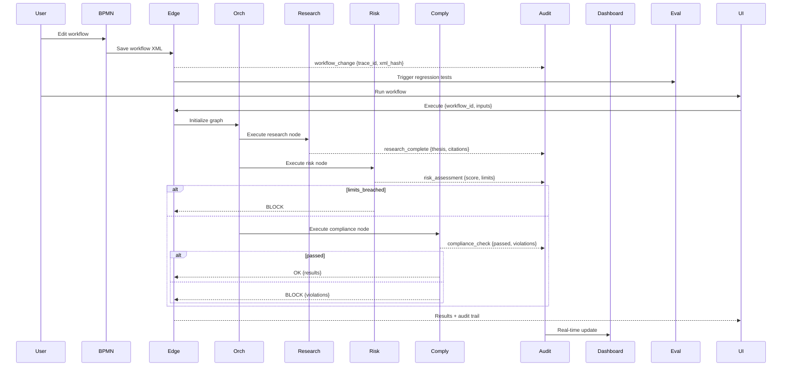

# Mission Control — Architecture Deep Dive

> This document captures the *why* behind major decisions. Implementation details are in the private repo.

---

## 1. Context & Constraints

**Business context:** Mission Control is the cloud development environment for Novaxis OS / Atlas — a unified workspace where developers and domain experts collaboratively build, test, and monitor multi-agent trading advisory systems.

**Regulatory constraints:**
- Full audit trail for every agent decision (SOX, SEC Rule 17a-4)
- Model explainability for risk assessments (Basel III, MiFID II)
- Data residency: US/EU separation capability
- Role-based access control (RBAC) for team collaboration
- 7-year audit log retention

**Technical constraints:**
- Real-time collaboration (multi-user editing)
- Sub-second latency for BPMN editor interactions
- Support 10+ concurrent users per workspace
- Vercel + Supabase free/pro tiers for cost control

**Non-goals:**
- Order execution (OMS/EMS)
- Real-time market making
- Custom model training infrastructure

---

## 2. High-Level Architecture

```mermaid
%%{init: {'theme': 'base', 'themeVariables': {
  'primaryColor': '#0B2D4A',
  'primaryTextColor': '#fff',
  'primaryBorderColor': '#00C9A7',
  'lineColor': '#888',
  'secondaryColor': '#1A1A2E',
  'tertiaryColor': '#E85D4D',
  'background': 'transparent',
  'mainBkg': 'transparent',
  'secondBkg': 'transparent',
  'tertiaryBkg': 'transparent'
}}}%%
flowchart TB
    subgraph Client[Client Layer]
        UI[Next.js 15 Dashboard]
        BPMN[bpmn-js Editor]
        Viz[Three.js Viz]
        Collab[Yjs CRDT Sync]
    end
    subgraph Backend[Supabase Backend]
        Auth[Auth + RLS]
        Realtime[Realtime Server]
        Edge[Edge Functions]
        PG[(PostgreSQL + pgvector)]
        Storage[S3-compatible Storage]
    end
    subgraph Agents[Agent Runtime (Edge Functions)]
        Orch[Orchestrator]
        Research[Research Agent]
        Risk[Risk Agent]
        Comply[Compliance Agent]
    end
    subgraph Data[Data Layer]
        Market[Market Data APIs]
        News[News Feeds]
        Vector[pgvector Index]
        Cache[Redis]
    end
    subgraph Governance[Governance]
        Audit[Audit Logger]
        Eval[Eval Harness]
        Dashboard[Compliance Dashboard]
    end

    UI --> Auth
    UI --> Realtime
    BPMN --> Realtime
    BPMN --> Edge
    Viz --> PG
    Collab --> Realtime
    Edge --> Orch
    Orch --> Research
    Orch --> Risk
    Orch --> Comply
    Research --> Market
    Research --> News
    Research --> Vector
    Risk --> Market
    Comply --> PG
    Orch --> Audit
    Audit --> Dashboard
    Eval --> Audit

    style Client fill:#0B2D4A,color:#fff
    style Backend fill:#1A1A2E,color:#fff
    style Agents fill:#1A1A2E,color:#fff
    style Data fill:#00C9A7,color:#0B2D4A
    style Governance fill:#E85D4D,color:#fff
```

---

## 3. Key Design Decisions (ADR Summaries)

| ADR | Decision | Rationale | Trade-offs |
|-----|----------|-----------|------------|
| [001](docs/adr/001-nextjs-supabase.md) | Next.js 15 + Supabase over custom stack | Unified auth/db/realtime/edge, Vercel deploy, TypeScript end-to-end | Vendor lock-in; less control over infra |
| [002](docs/adr/002-bpmn-integration.md) | bpmn-js for visual workflow definition | Domain experts can read/modify; executable XML; version-controllable | Bundle size; BPMN semantic gaps for AI agents |
| [003](docs/adr/003-edge-functions.md) | Supabase Edge Functions for agent runtime | Colocated with data; auto-scaling; Deno runtime; low latency | Deno ecosystem; cold starts; 2s timeout |
| [004](docs/adr/004-audit-log-design.md) | Structured JSONL + trace IDs + RLS | Queryable, correlates with traces, compliance-ready, tenant isolation | Storage volume; schema evolution |
| [005](docs/adr/005-eval-harness.md) | Custom harness + regression + red-team gates | Domain-specific thresholds, blocks bad deploys, BPMN change triggers | Maintenance burden |

---

## 4. Agent / Component Specs

### `BPMN Editor` — Visual Workflow Definition
- **Trigger:** User creates/edits BPMN 2.0 diagram
- **Inputs:** BPMN XML + custom extensions (AI node types, tool calls, guardrails)
- **Outputs:** Executable agent graph (JSON) + version-controlled XML
- **Governance:** Every save emits `workflow_change` audit entry; triggers eval harness
- **Failure modes:** Invalid BPMN → validation errors; semantic gaps → custom extension nodes

### `Agent Orchestrator` — Graph Execution Engine
- **Trigger:** API call or scheduled run with workflow ID + inputs
- **Inputs:** `{ workflow_id, inputs, trace_id, user_id }`
- **Nodes:** Research, Risk, Compliance, Custom (extensible)
- **Outputs:** `{ results, audit_trail, trace_id }`
- **Governance:** Every node emits audit entry; Compliance node = hard gate
- **Failure modes:** Node timeout → partial results + degradation; Compliance fail → hard block

### `Research Agent` — Market Analysis & Synthesis
- **Trigger:** Orchestrator → Research node
- **Tools:** Market data, news search, SEC filings, vector search
- **Governance:** Citations verified; tool calls logged; confidence scored

### `Risk Agent` — Portfolio & Position Risk
- **Trigger:** Orchestrator → Risk node (post-research or standalone)
- **Tools:** Portfolio load, VaR calc, stress test, concentration check
- **Governance:** `risk_assessment` audit entry; hard gate on limits breach

### `Compliance Agent` — Rule Validation
- **Trigger:** Orchestrator → Compliance node (always runs pre-output)
- **Tools:** Rule engine (TypeScript, version-controlled)
- **Governance:** `compliance_check` audit entry; **fail-closed** — blocks output on violation

---

## 5. Data Flow & State Management



**State persistence:** Supabase PostgreSQL (workflows, audit, user data) + pgvector (research corpus) + Redis (session cache, rate limits)  
**Idempotency:** `trace_id` (UUID v7) per execution; re-runs safe (audit deduplication)  
**Consistency model:** Strong for workflow CRUD (RLS); eventual for audit aggregation; real-time for collaboration (Supabase Realtime + Yjs CRDT)

---

## 6. Governance Implementation

### Audit Logging
- **Every workflow change:** `trace_id`, `xml_hash`, `user_id`, `timestamp`, `diff_summary`
- **Every node execution:** `trace_id`, `node_id`, `input_hash`, `output_hash`, `duration_ms`, `success`
- **Every tool call:** `trace_id`, `tool_name`, `args_hash`, `result_hash`, `duration_ms`
- **Storage:** Loki (30-day hot) + PostgreSQL (7-year cold, RLS-enforced) + S3 (raw, 90-day)

### Eval Harness
| Suite | Trigger | Gate | Threshold |
|-------|---------|------|-----------|
| Regression | PR + workflow change | Block merge | 95% pass |
| Red-team | Weekly | Alert | 0 critical |
| BPMN semantic validation | Workflow save | Block save | 0 errors |
| Drift detection | Daily | Alert | >5% shift |

### Risk Register (Living Document)
| ID | Risk | Likelihood | Impact | Mitigation | Owner | Status |
|----|------|------------|--------|------------|-------|--------|
| R-01 | BPMN semantic gap for AI nodes | Medium | High | Custom extensions + validation layer | Jane | Active |
| R-02 | Edge Function cold start latency | High | Medium | Warm pools + keep-alive | Jane | Monitored |
| R-03 | Realtime sync conflict | Low | High | Yjs CRDT + audit trail | Jane | Active |
| R-04 | Multi-tenant data leakage | Low | Critical | RLS on all tables + audit | Jane | Active |

---

## 7. Failure Modes & Runbooks

| Scenario | Detection | Mitigation | Runbook |
|----------|-----------|------------|---------|
| Edge Function timeout | 2s limit exceeded | Async execution + polling | `runbooks/edge-timeout.md` |
| Realtime disconnect | Supabase Realtime error | Auto-reconnect + state resync | `runbooks/realtime-disconnect.md` |
| Eval regression | Nightly gate fails | Auto-revert + alert | `runbooks/eval-regression.md` |
| RLS policy error | 403 on valid query | Audit log + emergency bypass | `runbooks/rls-error.md` |

---

## 8. Scaling & Cost Model

| Component | Current Scale | Projected (12mo) | Cost Driver | Optimization |
|-----------|---------------|------------------|-------------|--------------|
| Edge Function invocations | 10k/day | 500k/day | Invocation count + duration | Batching, caching, warm pools |
| Realtime connections | 50 concurrent | 500 concurrent | Connection hours | Connection pooling |
| pgvector index | 1M vectors | 10M vectors | Index size + query latency | Partitioning, quantization |
| Audit logs | 5GB/day | 50GB/day | Ingestion + retention | Tiered storage, compression |

---

## 9. Future Work (Roadmap)

- [ ] **Multi-region deploy** for data residency (EU/GDPR)
- [ ] **Formal verification** of critical agent paths (TLA+ / Alloy)
- [ ] **Automated ADR generation** from commit messages + PR titles
- [ ] **Compliance dashboard** for auditors (read-only, real-time)
- [ ] **MCP integration** for standardized tool interfaces
- [ ] **GitOps workflow** for BPMN → deploy pipeline

---

*Architecture owned by Jane Riveros — questions: `jdriveros232@gmail.com`*